# 🌿 Kura — Learning Management System


A full-stack LMS with **students, instructors and admins**: build courses from modules and Markdown lessons, set assignments and auto-graded quizzes, track every learner’s progress, and manage student records. *Kura* means “school” in te reo Māori.

**Live demo:** _coming soon_

| Role | Email | Password |
|---|---|---|
| Student | `student@example.com` | `Student1234!` |
| Instructor | `instructor@example.com` | `Teach1234!` |
| Admin | `admin@example.com` | `Admin1234!` |

Or use the one-click demo buttons on the login page.

<!-- Add screenshots to docs/ and uncomment:


-->

## Features

### Students
- Dashboard with per-course **progress bars**, upcoming deadlines and recent grades
- Course catalogue with search; self-enrol and leave courses
- Markdown lessons with previous / next navigation and **mark complete & continue**
- Assignments: submit text or links, resubmit until graded, see grade, NZQA-style band (Achieved / Merit / Excellence) and feedback
- Quizzes: auto-graded multiple choice with limited attempts and a pass mark; best attempt counts

### Instructors
- Course builder: modules, lessons (Markdown), assignments and quizzes in one place
- Quiz editor with 2–6 options per question
- Publish / unpublish — publishing an empty course is blocked
- Gradebook: roster with progress and current grade for each student
- Grading queue per assignment with late flags and written feedback

### Admins — student records management
- Create, view, update and delete students, instructors and admins
- **Sequential student numbers** (`S2026-0001`) assigned automatically
- Search by name, email or student number; filter by role
- Enrol or remove students from any course and view their progress
- Platform stats: users, published/draft courses, enrolments, submissions awaiting grading

## Tech stack

| Layer | Tech |
|---|---|
| Frontend | React 18, TypeScript, Vite, React Router, TanStack Query, react-markdown |
| Backend | Node.js, Express 5, TypeScript, Zod validation |
| Database | PostgreSQL 16, Prisma ORM |
| Testing | Vitest, Supertest (integration tests against a real Postgres), React Testing Library |
| DevOps | Docker (multi-stage), docker-compose, GitHub Actions CI |

## Architecture

```mermaid
erDiagram
  User ||--o{ Course : teaches
  User ||--o{ Enrollment : has
  Course ||--o{ Enrollment : has
  Course ||--o{ Module : contains
  Module ||--o{ Lesson : contains
  Course ||--o{ Assignment : sets
  Course ||--o{ Quiz : sets
  Quiz ||--o{ QuizQuestion : has
  User ||--o{ LessonCompletion : records
  Lesson ||--o{ LessonCompletion : "completed in"
  Assignment ||--o{ Submission : receives
  User ||--o{ Submission : makes
  Quiz ||--o{ QuizAttempt : receives
  User ||--o{ QuizAttempt : makes
```



```
server/src
├── lib/
│   ├── grading.ts      pure rules: quiz marking, progress %, course grade (unit tested)
│   ├── progress.ts     batched progress for a whole roster in 6 queries (no N+1)
│   ├── access.ts       single place for "can teach" / "can learn" authorisation
│   └── studentNumber.ts  race-safe sequential student numbers
└── routes/
    ├── courses.ts  catalogue, syllabus, enrolment
    ├── learn.ts    lessons, submissions, quiz attempts
    ├── me.ts       student dashboard
    ├── teach.ts    course builder, grading, roster
    └── admin.ts    student records management
```

## Design decisions

- **Quiz answers never leave the server for students.** The student quiz endpoint doesn’t select `correctIndex`, and attempt results only say *whether* each answer was right — so later attempts can’t be gamed. An integration test asserts the field never appears in the payload.
- **Questions lock after the first attempt.** Instructors can still change the title, pass mark and attempt limit, but changing questions would invalidate earlier scores, so the API returns `409`.
- **Authorisation lives in one module** (`access.ts`). Every lesson, assignment, quiz and submission route resolves its parent course and goes through `teachableCourse` or `assertCanLearn`. Content in other instructors’ courses returns `404`, so IDs can’t be probed.
- **Progress is computed, not stored.** Each lesson, assignment and quiz counts equally; there’s no counter to drift out of sync when content is added or removed. Roster progress is calculated in a fixed number of grouped queries regardless of class size.
- **Graded work is immutable to students.** Resubmission replaces the previous version until an instructor grades it, then returns `409`. Instructors can’t lower `maxPoints` below a grade already awarded.
- **Safe Markdown.** Lessons are rendered with `react-markdown`, which ignores raw HTML by default, so lesson content can’t inject scripts.
- **No privilege escalation at sign-up.** Self-registration always creates a student; instructors and admins can only be created by an admin.

## Getting started

Prerequisites: Node.js 20+, Docker Desktop

```bash
npm install
npm run db:up                         # Postgres on localhost:5434
cp server/.env.example server/.env    # then set a real JWT_SECRET
npm run db:migrate -w server
npm run db:seed -w server             # 3 courses, 6 students with realistic progress
npm run dev                           # API on :4200, web on http://localhost:5175
```

## Testing

```bash
npm test          # server unit + integration, client component tests
npm run typecheck
```

Integration tests cover role enforcement, publishing rules, cross-instructor isolation, draft visibility, enrolment gating, quiz answer secrecy and attempt limits, question locking, progress calculation, the submission → grading → lock flow, and admin CRUD for student records.

## API overview

| Area | Endpoints |
|---|---|
| Auth | `POST /api/auth/register` · `POST /api/auth/login` · `POST /api/auth/logout` · `GET /api/auth/me` |
| Catalogue | `GET /api/courses` · `GET /api/courses/:id` · `POST/DELETE /api/courses/:id/enroll` |
| Learning | `GET /api/learn/lessons/:id` · `POST/DELETE /api/learn/lessons/:id/complete` · `GET /api/learn/assignments/:id` · `POST /api/learn/assignments/:id/submit` · `GET /api/learn/quizzes/:id` · `POST /api/learn/quizzes/:id/attempts` · `GET /api/me/dashboard` |
| Teaching | `GET/POST /api/teach/courses` · `GET/PUT/DELETE /api/teach/courses/:id` · `POST /api/teach/courses/:id/{modules,assignments,quizzes}` · `PUT/DELETE /api/teach/{modules,lessons,assignments,quizzes}/:id` · `POST /api/teach/modules/:id/lessons` · `GET /api/teach/courses/:id/students` · `GET /api/teach/assignments/:id/submissions` · `PATCH /api/teach/submissions/:id` |
| Admin | `GET /api/admin/stats` · `GET/POST /api/admin/users` · `GET/PUT/DELETE /api/admin/users/:id` · `POST /api/admin/users/:id/enrollments` · `DELETE /api/admin/users/:id/enrollments/:courseId` |

## Deployment

One Docker image serves both the API and the built React app, and runs migrations on start-up.

1. Create a PostgreSQL database (e.g. [Neon](https://neon.tech) free tier).
2. Create a Web Service on [Render](https://render.com) from this repo using the Dockerfile.
3. Set `DATABASE_URL`, `JWT_SECRET` (long random string) and `NODE_ENV=production`.
4. Run `npx prisma db seed` once for the demo accounts.

## Roadmap

- Drag-and-drop reordering of modules and lessons
- File uploads for submissions (S3 / Cloudflare R2)
- Course completion certificates (PDF)
- Discussion threads per lesson
- CSV import of student records

---

All people and course content in the seed data are fictional.
